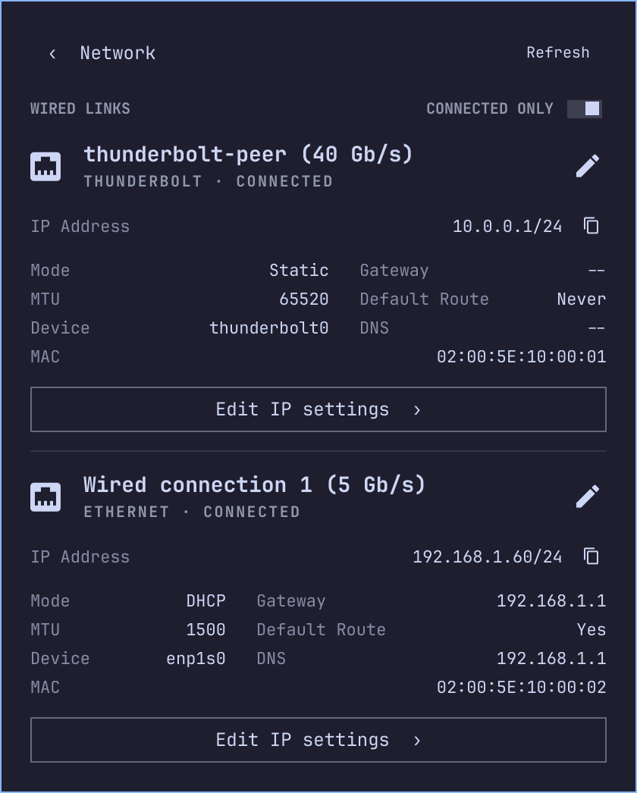
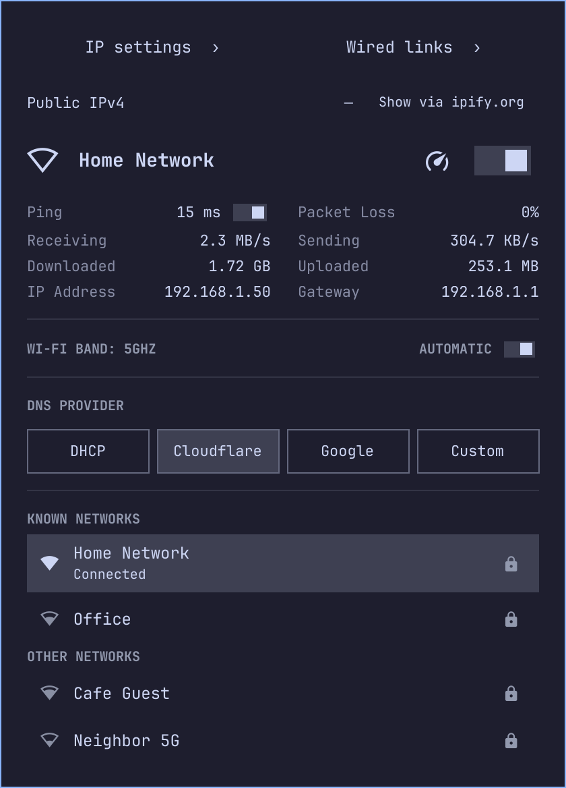
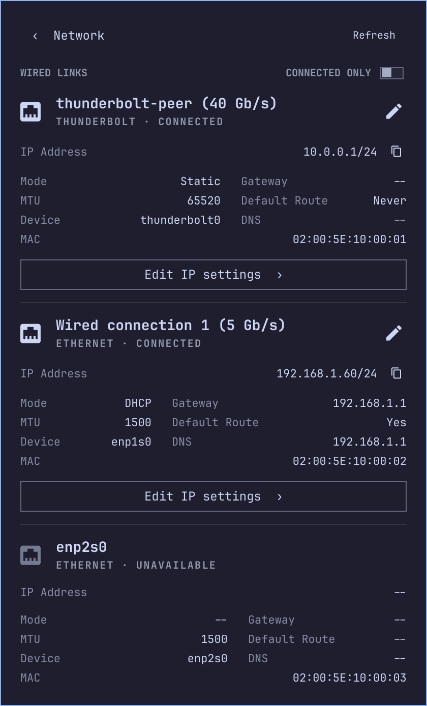
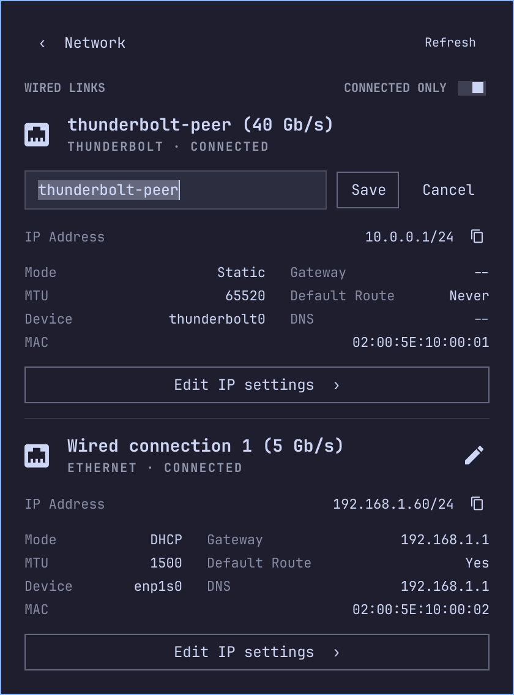
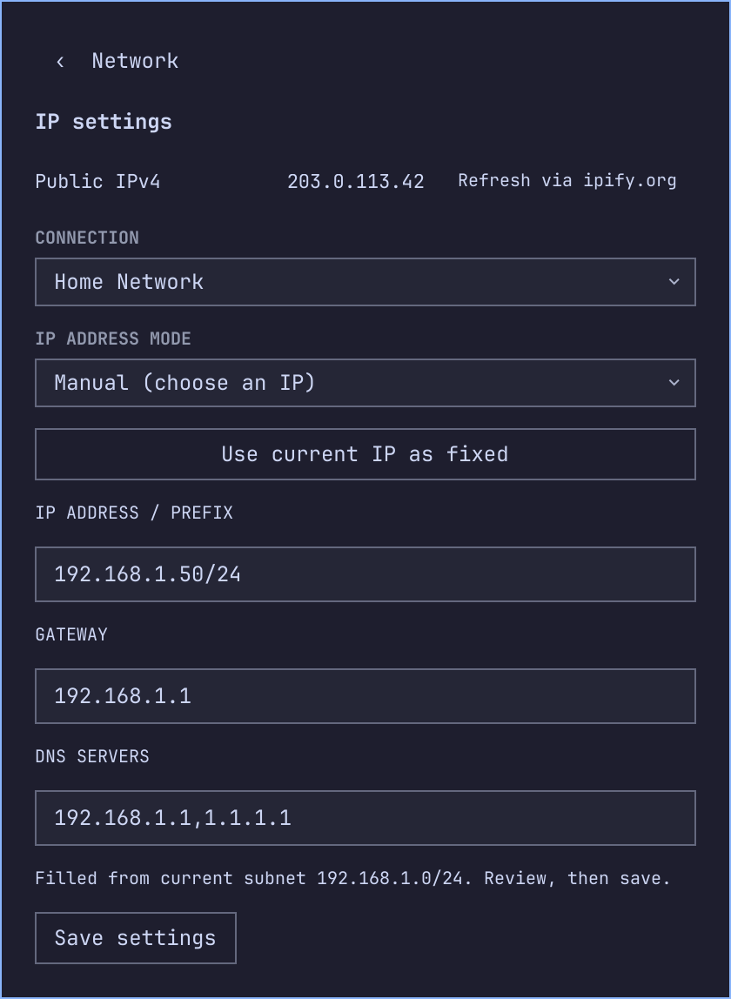
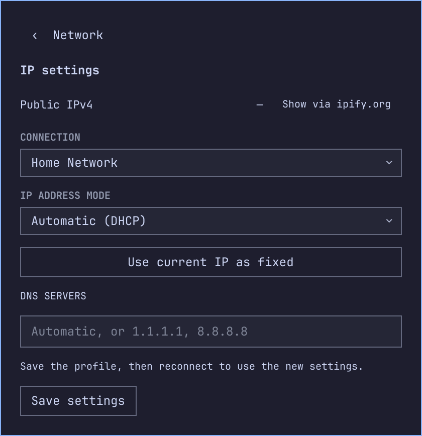

# Netdeck

Every network link on your machine in one Omarchy bar panel: Wi-Fi, Ethernet
and Thunderbolt networking. It replaces the stock `omarchy.network` widget and
keeps everything it does, then adds a wired links view, a public IPv4 lookup
and an IP settings editor.

Built for desks where machines talk over direct cables, such as two computers
joined by a Thunderbolt cable, while still working as a normal laptop network
widget.



## Screenshots

<table>
<tr><th>Network panel</th><th>All wired links</th></tr>
<tr><td></td><td></td></tr>
<tr><th>Renaming a link</th><th>IP settings: fixed address</th></tr>
<tr><td></td><td></td></tr>
<tr><th>IP settings: DHCP</th><th></th></tr>
<tr><td></td><td></td></tr>
</table>

The screenshots are the real QML rendered offscreen in Omarchy's Catppuccin
theme, with made-up network names and documentation-range addresses.

## What it adds to the stock widget

**Wired links** (`e`, or *Wired links ›*): every Ethernet device, Thunderbolt
networking included. For each one:

- name and link speed, and whether it is Ethernet or Thunderbolt;
- state, IPv4 address with a copy button, and DHCP or static;
- gateway, DNS, MTU, MAC (click a value to copy it);
- whether it can take the default route. A direct cable between two machines
  should say *Never*, so your internet traffic stays on your normal network;
- a pencil to rename the connection in place (Enter saves, Esc cancels). Only
  the NetworkManager profile name changes, so the link stays up;
- *Edit IP settings ›*, which opens that link in the IP settings screen.

The *Connected only* switch hides ports with no cable or peer. It is
remembered across shell restarts in `~/.local/state/omarchy/netdeck.json`.

**IP settings** (`s`, or *IP settings ›*): pick any saved Wi-Fi or Ethernet
profile and switch it between DHCP and a fixed IPv4 address, gateway and DNS.
*Use current IP as fixed* fills the form from the address you have now.

**Public IPv4**: looks up your public address through
[ipify.org](https://api.ipify.org), only when you click the button. The button
names the service, because the lookup is a request to a third party.

**Ping, opt-in**: the switch beside *Ping* turns latency and packet loss on.
It is off by default and remembered in `netdeck.json`. See
[Network access](#network-access) for what it sends.

## Requirements

- Omarchy with the Quickshell shell (Quattro)
- NetworkManager, with `nmcli` on `PATH`
- Python 3 (standard library only)
- `bash`, `ip` and `iw`, which the stock widget already uses

No background service. See [Network access](#network-access) for the only
requests it makes.

## Network access

Netdeck sends nothing on its own. It only reaches the network after you choose
to:

| What | Sends | When |
|---|---|---|
| *Show via ipify.org* | One HTTPS request to `api.ipify.org` | Each click |
| *Ping* switch | One ICMP echo to your gateway and one to `1.1.1.1` | Every 1.5 s while the panel is open and the switch is on |
| Speedometer button | Whatever Omarchy's own `omarchy.speedtest` panel does | When you click it and start a test there |

The pings come from Omarchy's `omarchy-network-status --verbose`, the same
command the stock widget runs every 1.5 s. With the switch off, Netdeck reads
the interface, address, gateway, byte counts and link details itself
(`settings.py details`). It uses `ip route get`, which only reads the local
routing table, plus `/sys` and `iw`, so no packet leaves the machine.

## Install

```bash
omarchy plugin add https://github.com/douglas/netdeck --enable
```

Netdeck is a replacement for `omarchy.network` (`clonedFrom` in
`manifest.json`), so it takes the stock widget's place in the bar and answers
its keybindings.

## Remove

```bash
omarchy plugin remove io.github.douglas.netdeck --yes
```

Removing it while it is enabled turns the stock widget back on. If you removed
it while it was disabled, turn the stock widget on yourself:

```bash
omarchy plugin enable omarchy.network
```

Netdeck keeps one small state file. Delete it too if you like:

```bash
rm -f ~/.local/state/omarchy/netdeck.json
```

## Keys

| Key | Action |
|---|---|
| `e` | Open wired links |
| `s` | Open IP settings |
| `r` | Refresh |
| `w` | Turn Wi-Fi on or off |
| `Esc` | Go back, or close the panel |

## How it works

`Panel.qml` is the stock widget plus the screens above. Live Wi-Fi state comes
from the `Quickshell.Networking` types the stock widget already uses.

Everything that talks to NetworkManager goes through `settings.py`. It takes
one action (`public`, `list`, `read`, `current`, `save`, `wired`, `rename` or
`details`),
prints one JSON object, and reports errors as `{"error": "..."}`. It calls
`nmcli` with argument lists, never through a shell.

What it can change, and the checks before it does:

- `save` sets only the IPv4 method, addresses, gateway and DNS of a Wi-Fi or
  Ethernet profile. It refuses IPv6, an address without a prefix, and any other
  profile type. Going back to DHCP clears the static address and gateway.
- `rename` changes only the profile name. It refuses empty names, control
  characters, names over 64 characters, and a name another connection uses.
- `wired` and `details` only read.

Wi-Fi passphrases never reach `settings.py`: the stock code passes them on
stdin to `nmcli`, because command-line arguments are visible in `/proc`.

## Tests

```bash
bash test/run
```

| File | Covers |
|---|---|
| `test/model.test.js` | The pure helpers in `Model.js` |
| `test/settings.test.py` | Every `settings.py` action against a fake `nmcli`, so no real connection changes |
| `test/manifest.test.py` | The manifest, its entry point, and `omarchy plugin validate` |
| `test/integration.test.js` | Real `nmcli` and `omarchy-network-band` output on this machine (read-only) |

GitHub Actions runs the first three on every push and pull request. The
integration test needs NetworkManager and Omarchy, so it runs locally.

To regenerate the screenshots:

```bash
python3 tools/render-previews.py
```

It runs the real `Panel.qml` offscreen with made-up data, in a stock Omarchy
theme (`catppuccin` by default; pass another theme name to change it). It
never captures your screen, reads NetworkManager or contacts ipify.org.

## Keeping up with the stock widget

The stock widget lives in `/usr/share/omarchy/shell/plugins/panels/network/`.
`Model.js` here is identical to stock, and `Panel.qml` carries Netdeck's
additions on top, so port stock fixes across rather than re-cloning.

## Credits

Netdeck began as [rohi.network](https://github.com/RohiRIK/rohi.network) by
Rohi Rikman, which added the public IPv4 lookup and the IP settings editor to
Omarchy's [`omarchy.network`](https://github.com/basecamp/omarchy) widget.

## License

MIT. See [LICENSE](LICENSE).
